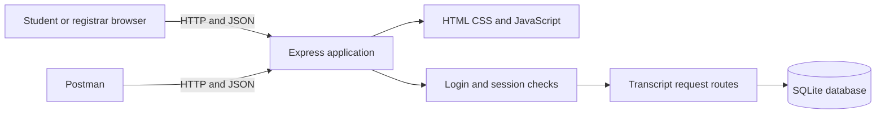
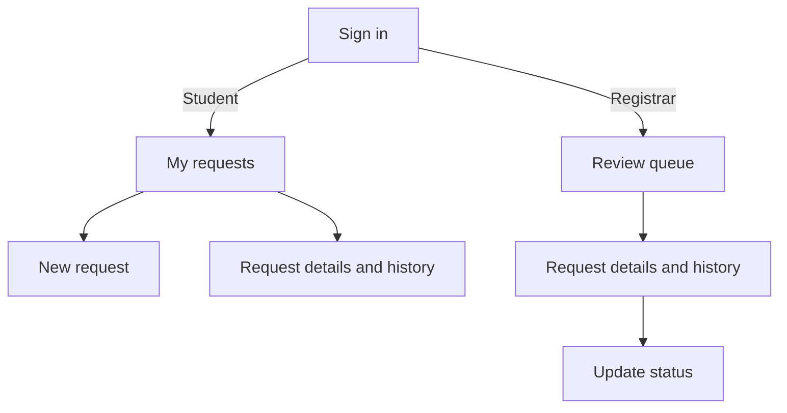

# Transcript Tracker design

## Application architecture

The browser loads the HTML, CSS and JavaScript from Express. Browser actions and Postman requests call the same JSON API. Express parses the request and dispatches it to the login or transcript router. Authentication middleware looks up the bearer session. The request router checks roles and ownership before reading or changing records. SQLite stores data in `data/registrar.sqlite` between runs.

`server.js` starts the listener. `app.js` serves the static files and mounts the routers. The route handlers in `routes/` perform the controller work. `auth.js` checks the session and role. `db.js` defines the schema and provides transactions. A status change and its history entry commit together. Queries use bound parameters for submitted values.

## Data model

| Table | Primary key | Relationships and purpose |
| --- | --- | --- |
| users | id | Account name, email, password hash and role |
| sessions | token_hash | user_id references users.id. Stores the expiry of a hashed bearer token |
| requests | id | student_id references users.id. Stores the purpose, status and creation time |
| history | id | request_id references requests.id and actor_id references users.id. Stores the status, note and time |

A student can have many requests. Each request can have many history entries. Each history entry identifies the user who acted. The student ID comes from the authenticated account, so a browser cannot choose another owner by changing a form field.

## Sitemap

These are views within the single page at `/`. The signed-in account determines which view and actions the page displays. The API applies the same access rules to requests sent directly from Postman.

## Page structure

| View | Visible content | API calls |
| --- | --- | --- |
| Sign in | Heading, labelled email and password fields, sign-in button and status message | POST /api/auth/login |
| Create account | Name, email and password fields for student registration | POST /api/auth/register |
| Student workspace | Account heading, request form, personal request list and refresh control | GET /api/auth/me, GET /api/requests, POST /api/requests |
| Registrar workspace | Account heading, review queue, refresh control and access to request details | GET /api/requests |
| Request details | Reference, purpose and ordered status history. Registrar accounts can see the applicable status form | GET /api/requests/:id, PATCH /api/requests/:id/status |
| Sign out | Shared header action | POST /api/auth/logout |

The page uses a header, main content, sections and footer. Forms use explicit labels. The request list uses buttons for opening records, and status history is an ordered list. A status region announces feedback. CSS wraps the workspace columns on narrow screens. JavaScript handles form submission and updates the page from API responses, inserting user text with `textContent`.

## Request lifecycle

A student submits a reason containing 5 to 300 characters. The API creates the request and the first history entry, then responds with HTTP 201 and a reference. A registrar can move it from Submitted to Under review, then to Ready for collection or Rejected. A rejection requires a reason. A disallowed transition returns HTTP 409. A student attempting a staff update receives HTTP 403. An unrelated student looking up the request receives HTTP 404.

[Editable diagrams](Transcript_Tracker.drawio) · [Browser mockups](Mockups.html)

[Architecture PNG](architecture.png) · [Sitemap PNG](sitemap.png) · [Data model PNG](data-model.png)
